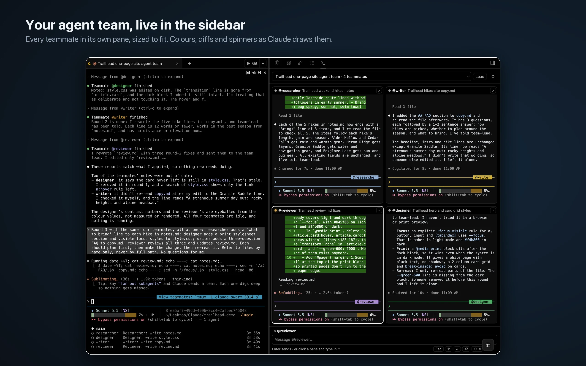

# Tmux Peek

Watch, message and drive your Claude Code agent teammates from Orca's right sidebar.
**macOS and Linux · needs tmux and Claude Code's tmux teammate mode** ([setup](#requirements)).



When a Claude Code lead starts an [agent team](https://docs.claude.com/en/docs/claude-code) in tmux mode, it pins a line like
`View teammates: tmux -L claude-swarm-12345 a` in the chat. Tmux Peek finds those lines in the
workspace you have open and shows every teammate live, without leaving Orca.

## What you can do

- **Pick a team** from the dropdown: one entry per lead chat in this workspace.
- **See every teammate** in its own pane, in colour, with its `@name`, model and a busy dot.
  1–3 teammates stack in one column, 4–6 use two columns, more scroll three rows at a time.
- **Type into a teammate:** click its pane (green outline, "typing") and type. Enter, arrows, Esc,
  Tab, Shift+Tab, Backspace, Ctrl-keys, Option+Enter for a new line, and paste all go straight to it.
- **Click inside a pane** to expand "Ran 2 shell commands", pick menu options and so on.
- **Scroll** a pane with the wheel; Claude scrolls its own view.
- **Paste an image** (Cmd+V on a pane or in the message bar): Claude attaches it as `[Image #1]`.
- **Message a teammate** from the bar at the bottom.
- **Maximize** one teammate inside the panel with the expand button; press it again to go back.
- **Lead** brings the chat that owns the team to the front.

Panes are resized in tmux to fit the panel, so each agent draws to its real size.

## Requirements

> **macOS and Linux only.** Tmux Peek reads Claude Code's tmux windows, and tmux does not run on
> Windows. On Windows the panel says so and shows nothing else.

1. **Orca 1.4.248 or newer.**
2. **tmux**: `brew install tmux` on macOS, your package manager on Linux. Tmux Peek looks in
   `/opt/homebrew/bin`, `/usr/local/bin`, `/usr/bin`, `/bin` and `/snap/bin`, then your `PATH`.
3. **Claude Code agent teams, shown in tmux.** Teammates only get a tmux window when Claude Code
   is told to use one. In `~/.claude/settings.json`:

   ```json
   {
     "env": { "CLAUDE_CODE_EXPERIMENTAL_AGENT_TEAMS": "1" },
     "teammateMode": "tmux"
   }
   ```

   Then ask a Claude chat in Orca to start an agent team. When the chat pins
   `View teammates: tmux -L … a`, the team appears in Tmux Peek's dropdown.

Tmux Peek works with local workspaces. Teams running on an SSH host are not shown yet.

Tested on macOS with Orca 1.4.253 and Claude Code 2.1.322. Linux is expected to work but is untested.

## Access it asks for

- Runs its own background process (to call `tmux`, and the `orca` command for the Lead button).
- Reads the terminal list and terminal text of the workspace you have open, to find the pinned `tmux -L … a` line.

It sends nothing anywhere else.

## How it stays smooth

Orca lets a panel make 120 requests to its background process per 10 seconds. Tmux Peek's worker
watches tmux itself and pushes a new screen only when one changes; key presses go in small batches,
one at a time.

## License

MIT
